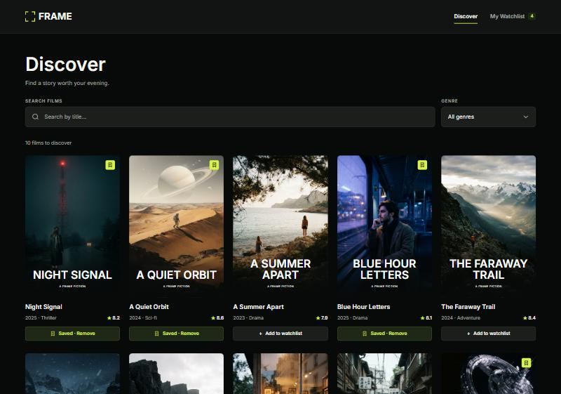
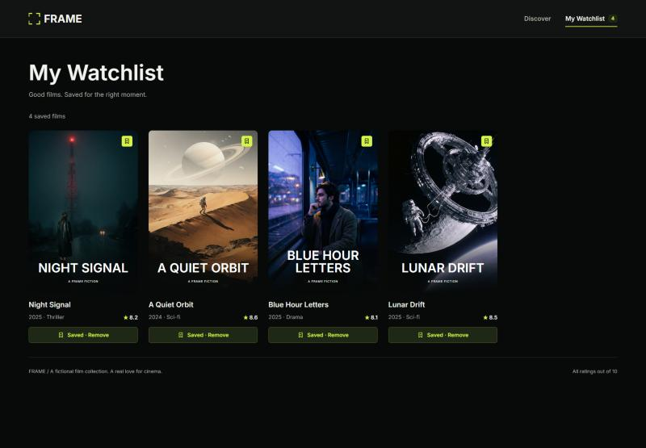
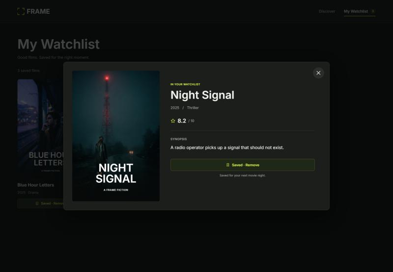

# FRAME — Movie Library

A small movie library app built with **React** and **TypeScript**.
Browse a collection of films, search them by title, filter by genre, open the details of any film and keep a personal watchlist that survives page reloads.

This is a practice project for learning React fundamentals: components, props, state, effects, custom hooks and accessible UI.



## Table of contents

- [Features](#features)
- [Screenshots](#screenshots)
- [Tech stack](#tech-stack)
- [Getting started](#getting-started)
- [Available scripts](#available-scripts)
- [Project structure](#project-structure)
- [How it works](#how-it-works)
- [Accessibility](#accessibility)
- [Code style and workflow](#code-style-and-workflow)

## Features

- **Discover**: a grid of 10 films with poster, title, year, genre and rating
- **Search by title**: debounced (500 ms), so the list doesn't update on every keystroke
- **Genre filter**: works together with search; the counter shows how many films were found
- **Movie details modal**: poster, full synopsis, year, genre and rating. It closes with the ✕ button, the `Escape` key or a click outside the modal.
- **Watchlist**: add or remove a film from a card or from the modal
  - the saved-film count is shown in the header
  - saved films get a bookmark badge on the poster
  - the **My Watchlist** page lists saved films, with an empty state when there are none
  - the watchlist is stored in `localStorage`, so it survives page reloads
- **Header navigation** between Discover and My Watchlist
- **Responsive layout**: 5 → 3 → 2 columns; the filters and the modal stack vertically on small screens
- **Keyboard and screen-reader friendly** (see [Accessibility](#accessibility))

## Screenshots

| My Watchlist                                         | Movie details                                              |
| ---------------------------------------------------- | ---------------------------------------------------------- |
|  |  |

## Tech stack

| Tool                                            | Purpose                               |
| ----------------------------------------------- | ------------------------------------- |
| [React 19](https://react.dev/)                  | UI library                            |
| [TypeScript 6](https://www.typescriptlang.org/) | Static types                          |
| [Vite 8](https://vite.dev/)                     | Dev server and build tool             |
| Plain CSS + CSS variables                       | Styling, BEM-style class names        |
| [ESLint](https://eslint.org/)                   | Linting (including React Hooks rules) |
| [Prettier](https://prettier.io/)                | Code formatting                       |

No UI libraries or state managers: everything is built with React itself.

## Getting started

### Prerequisites

- **Node.js** `20.19+` or `22.12+` (required by Vite 8)
- **npm** (comes with Node.js)

### Installation

```bash
git clone https://github.com/web-ui-practice/frame-movie-library.git
cd frame-movie-library
npm install
npm run dev
```

Then open http://localhost:5173 in the browser.

## Available scripts

| Command           | Description                                                 |
| ----------------- | ----------------------------------------------------------- |
| `npm run dev`     | Start the development server with hot reload                |
| `npm run build`   | Type-check with `tsc` and build for production into `dist/` |
| `npm run preview` | Serve the production build locally                          |
| `npm run lint`    | Check the code with ESLint                                  |
| `npm run format`  | Format all files with Prettier                              |

## Project structure

```text
frame-movie-library/
├── public/
│   └── posters/              # Movie poster images
├── docs/
│   └── screenshots/          # Images used in this README
├── src/
│   ├── assets/               # Logo and UI icons (SVG)
│   ├── components/
│   │   ├── Footer/           # Page footer
│   │   ├── Header/           # Logo and navigation with the watchlist count
│   │   ├── MovieCard/        # Film card used on both pages
│   │   ├── MovieModal/       # Movie details dialog
│   │   ├── WatchlistButton/  # Add / remove button (card and modal)
│   │   └── icons/            # Small inline SVG icons
│   ├── constants/
│   │   └── texts.ts          # UI texts in one place
│   ├── data/
│   │   └── movies.ts         # Mock movie data
│   ├── hooks/
│   │   └── useWatchlist.ts   # Watchlist state + localStorage
│   ├── types/
│   │   └── index.ts          # Shared TypeScript types (Movie, View)
│   ├── views/
│   │   ├── DiscoverView.tsx  # Search, genre filter and the movie grid
│   │   └── WatchlistView.tsx # Saved movies
│   ├── App.tsx               # Root component: current view + watchlist state
│   ├── index.css             # Global styles and CSS variables
│   └── main.tsx              # Entry point
├── index.html
├── package.json
└── vite.config.ts
```

Each component keeps its styles next to it (`MovieCard.tsx` + `MovieCard.css`).

## How it works

### Data

Movies are mock data in `src/data/movies.ts`. Each movie follows the `Movie` type:

```ts
interface Movie {
  id: number;
  title: string;
  year: number;
  genre: string;
  rating: number;
  posterUrl: string;
  description: string;
}
```

### State

```text
App
├── currentView        → which page is shown (Discover / My Watchlist)
└── useWatchlist()     → saved movie ids
     ├── Header        → shows the count
     ├── DiscoverView  → search, genre and the selected movie (local state)
     └── WatchlistView → selected movie (local state)
```

- **Navigation** is conditional rendering: `App` stores `currentView` and renders the matching view. No router is needed for two pages.
- **The watchlist lives in `App`** because three parts of the UI need it: the Header, Discover and My Watchlist. It goes down to them as props (lifting state up).
- **`useWatchlist`** is a custom hook. It reads the saved ids from `localStorage` once on start, writes them back after every change, and falls back to an empty list if the stored value is broken or storage isn't available.
- **Search** uses a debounce: `useEffect` with `setTimeout` and a cleanup function updates `debouncedSearch` 500 ms after the user stops typing.
- **The modal** is built on the native `<dialog>` element and `showModal()`, which gives `Escape` handling, a backdrop and an inert background out of the box.

### localStorage

| Key               | Value                                               |
| ----------------- | --------------------------------------------------- |
| `frame-watchlist` | JSON array of saved movie ids, e.g. `[1, 2, 4, 10]` |

To reset the watchlist, run `localStorage.removeItem('frame-watchlist')` in the browser console.

## Accessibility

- Semantic elements: `header`, `nav`, `main`, `footer`, `article`, `button`, `dialog`
- The active navigation item has `aria-current="page"`
- The whole movie card is clickable, and it's still a real `<button>`, so it works with `Tab` + `Enter`
- Watchlist buttons have descriptive labels, for example `aria-label="Add Night Signal to watchlist"`
- The header count is read as "My Watchlist, 4 saved" (visually hidden helper text)
- Modal:
  - `aria-labelledby` and `aria-describedby` point to the title and synopsis
  - focus moves into the modal and stays there while it's open
  - focus returns to the card that opened it after closing
  - page scroll is locked while it's open
- Visible focus styles (`:focus-visible`) on all interactive elements
- Decorative icons are hidden from screen readers with `aria-hidden="true"`

## Code style and workflow

- **Prettier** config: single quotes, semicolons, trailing commas, line width 100. Run `npm run format` before committing.
- **ESLint** must pass: `npm run lint`
- **Branches**: one branch per GitHub issue, named after it, e.g. `feature/7-watchlist`
- **Pull requests**: include `Closes #<issue>` in the description so the issue closes on merge, and list the acceptance criteria as a checklist

---

All movies, posters and descriptions are fictional and were made for this practice project.
